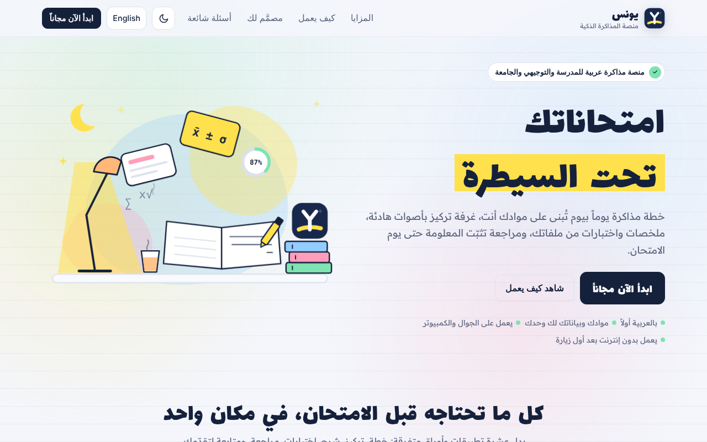

# Younis Ajaj

**Data Science & AI student · I build real AI products that people use**

Al-Ahliyya Amman University · Amman, Jordan

---

## About me

I'm a second-year **Data Science & Artificial Intelligence** student. I learn by shipping: I turn what I study in machine learning, data and software engineering into products that solve a real problem, then test them like production software.

**Focus:** machine learning · LLM-powered applications · data analysis · clean, tested code

---

## Featured project

### [Younis (يونس): smart study platform](younis-study/)

**Live:** https://younis-ajaj.github.io/Younis-Ajaj/

A free, Arabic-first exam-preparation platform for school and university students. Each student builds their own plan, then studies with an AI assistant, a focus room and spaced review.

- **Personal study plan:** a scheduling algorithm spreads study hours by difficulty and exam date, reschedules missed work, and exports to Google Calendar.
- **Ask Younis:** a chat assistant built on the Claude API, with tutoring instructions for accurate, step-by-step answers. Without a key it still answers from the student's own plan and files.
- **AI tutor:** explanations, mind maps, timed quizzes, auto flashcards and Feynman-style grading, plus a weekly AI report and mistake analysis.
- **Smart insights:** a readiness index per course and recommendations drawn from the student's real activity.
- **Engineering:** no backend, and data stays in the browser. Strict Content Security Policy, self-hosted libraries and fonts, and offline support as an installable PWA. 59 automated end-to-end checks with Playwright and axe. Lighthouse desktop: 100 for accessibility, best practices and SEO.

**Stack:** JavaScript · HTML/CSS · Anthropic TypeScript SDK (Claude) · pdf.js · Playwright · GitHub Pages

---

## Skills

| Area | Tools |
|---|---|
| Languages | Python, Java, SQL, JavaScript, HTML/CSS |
| AI & data | LLM integration (Claude API), prompt design, data analysis (learning), machine learning (learning) |
| Engineering | Git & GitHub, GitHub Pages, automated testing (Playwright), accessibility (axe), web security (CSP) |

## Currently learning

Machine learning foundations · data analysis with Python · algorithms · object-oriented programming

## Open to

Internships and student roles in **data science, machine learning and AI engineering**.

---

يونس أبو عجاج · طالب علم البيانات والذكاء الاصطناعي · أبني منتجات ذكاء اصطناعي حقيقية

