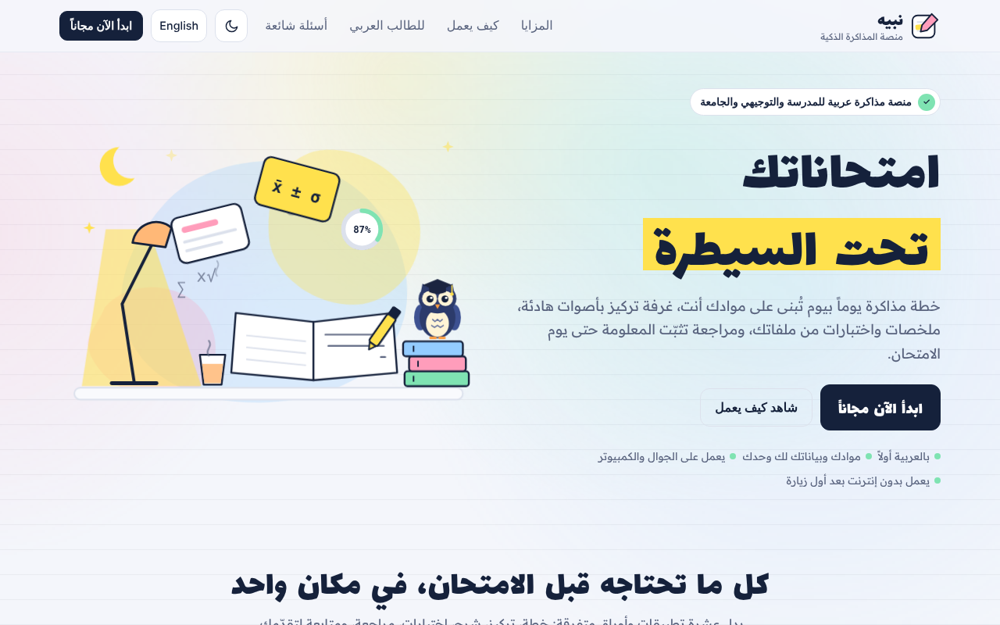
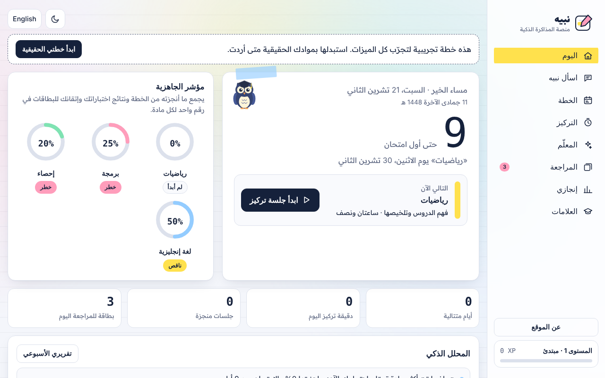
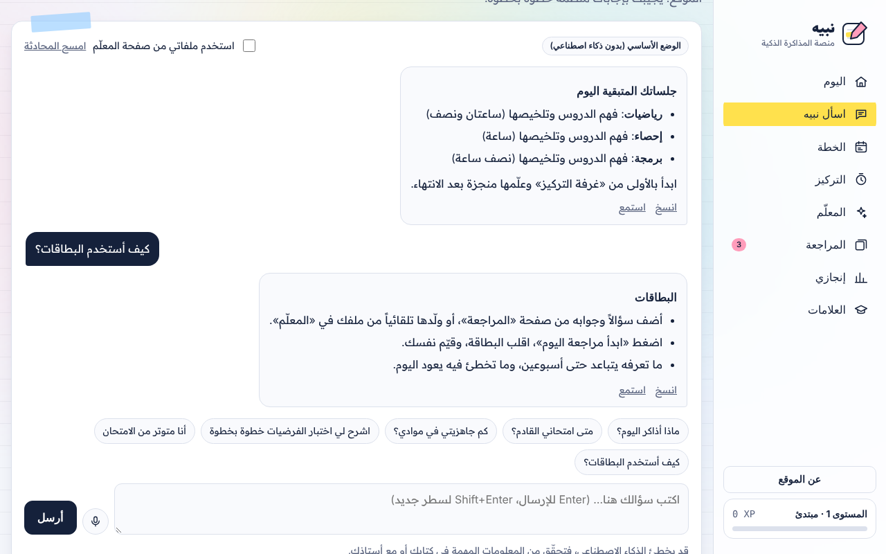
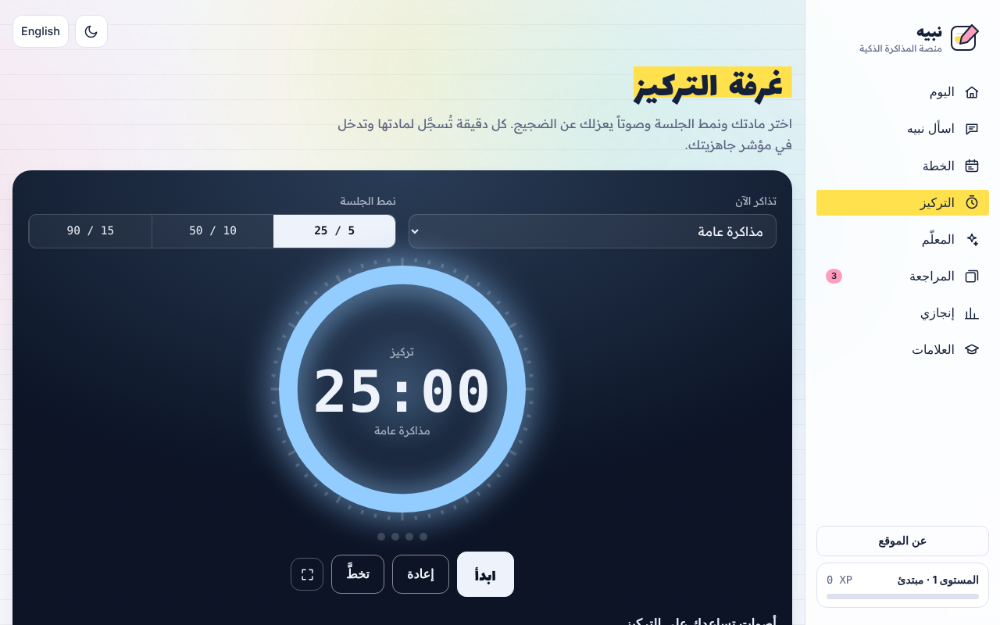
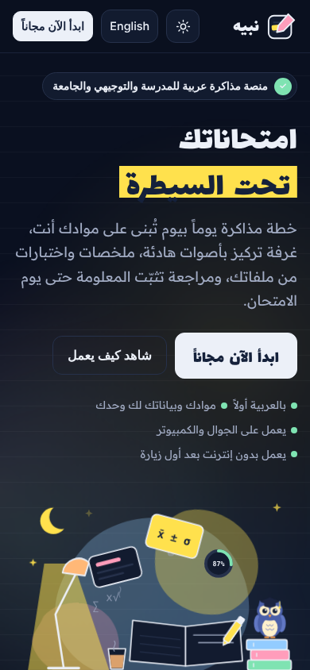

<div dir="rtl">

# نبيه: منصة المذاكرة الذكية

**منصة مذاكرة عربية مجانية لطلاب المدرسة والتوجيهي والجامعة:** خطة يومية تُبنى على موادك أنت، ومساعد محادثة «اسأل نبيه»، وغرفة تركيز، ومعلّم ذكي، ومراجعة متباعدة، ودفتر أخطاء، وأوقات الصلاة والتاريخ الهجري.

- **الموقع:** https://younis-ajaj.github.io/Younis-Ajaj/
- **نسخة Claude** (المعلّم الذكي يعمل فيها بحساب Claude بلا مفتاح): https://claude.ai/artifact/TXJqkw8BpsTdVT36RQevMt



## المزايا

| الأداة | ماذا تفعل لك |
|---|---|
| **معالج البداية** | تختار مرحلتك وبلدك وموادك (قوائم جاهزة للمدرسة والتوجيهي وتخصصات الجامعة، أو تكتب مادتك) ومواعيد امتحاناتك في دقيقة. |
| **الخطة اليومية** | خوارزمية توزّع ساعاتك على المواد حسب الصعوبة وقرب الامتحان، وتعيد توزيع ما فاتك دون أن تخسر ما أنجزته، وتصدّر الخطة إلى تقويم Google. |
| **اسأل نبيه** | مساعد محادثة يجيبك بإجابات منظّمة خطوة بخطوة. يعرف خطتك وامتحاناتك وجاهزيتك، ويشرح أدوات الموقع، ويبحث في ملفاتك، ومع المعلّم الذكي يجيب عن أي سؤال دراسي. |
| **مؤشر الجاهزية** | نسبة لكل مادة تجمع ما أنجزته ونتائج اختباراتك وإتقانك للبطاقات. |
| **المحلل الذكي** | توصيات من أرقامك الحقيقية: أخطر مادة الآن، وتيرتك الأسبوعية، أفضل وقت لتركيزك، وأين تتكرر أخطاؤك. |
| **غرفة التركيز** | بومودورو (25/5، 50/10، 90/15) بأصوات مطر وأمواج، وكل دقيقة تُسجَّل لمادتها، وتتوقف تلقائياً عند وقت الصلاة إن فعّلته. |
| **المعلّم** | ملخص واختبار من ملفات PDF وWord وPowerPoint وExcel داخل متصفحك. ومع المعلّم الذكي: شرح، وخريطة ذهنية، واختبار بتوقيت، وبطاقات تلقائية، وطريقة فاينمان. |
| **المراجعة** | بطاقات بالتكرار المتباعد، ودفتر أخطاء يجمع كل سؤال أخطأت فيه مع سببه، وتحليل ذكي للأخطاء. |
| **إنجازي** | مستويات ونقاط وأوسمة، وخريطة نشاط 16 أسبوعاً، وتقرير أسبوعي ذكي، ونسخة احتياطية. |
| **العلامات** | كم تحتاج في النهائي لتصل إلى هدفك، ومعدلك الفصلي والتراكمي. |
| **للطالب العربي** | واجهة عربية كاملة من اليمين إلى اليسار (والإنجليزية متى أردت)، والتاريخ الهجري، وأوقات الصلاة لـ 18 دولة عربية، وحكم وأمثال، ووضع «ليلة الامتحان». |

<p>


</p>
<p>


</p>

## دليل الطالب: ابدأ في دقيقة

1. افتح الموقع واضغط **«ابدأ الآن مجاناً»**.
2. اختر مرحلتك وبلدك، ثم موادك، ثم تاريخ امتحان كل مادة وصعوبتها.
3. اختر عدد ساعاتك اليومية، واضغط **«ابنِ خطتي»**.
4. كل يوم: افتح **«اليوم»**، وابدأ أول جلسة من **«غرفة التركيز»**، وعلّمها منجزة بعد الانتهاء.
5. اسأل **«اسأل نبيه»** عن أي شيء: «ماذا أذاكر اليوم؟»، «متى امتحاني القادم؟»، «كيف أستخدم البطاقات؟».
6. قبل النوم: راجع بطاقاتك المستحقة من **«المراجعة»**.
7. ثبّت الموقع على شاشة جوالك من قائمة المتصفح ← «إضافة إلى الشاشة الرئيسية»، فيعمل بدون إنترنت بعد أول زيارة.

### المعلّم الذكي و«اسأل نبيه»

- **بدون أي مفتاح** يجيبك «اسأل نبيه» عن خطتك وامتحاناتك وجاهزيتك وطريقة استخدام كل أداة، ويبحث في ملفاتك، ويساعدك في توتر الامتحان. ويعمل الملخص والاختبار من الملفات داخل متصفحك.
- **مع مفتاح Claude API الخاص بك** (صفحة «المعلّم» ← «فعّل») تعمل كل أدوات الذكاء الاصطناعي، ويجيب «اسأل نبيه» عن أي سؤال دراسي. يستخدم النموذج **Claude Opus 5.5** بتعليمات تدريس صارمة:
  - الدقة أولاً، ويقول إذا لم يكن متأكداً، ولا يخترع مصادر.
  - إجابة منظّمة: الخلاصة أولاً، ثم خطوات ومثال وأخطاء شائعة، وسؤال للتحقق من الفهم.
  - يكتب بلغة الطالب مع إبقاء المصطلحات العلمية بالإنجليزية.
  - يعلّمك ولا يحل امتحاناً مباشراً عنك.
  - إذا ذكر الطالب أزمة، يوجّهه بلطف إلى من يثق به أو إلى الطوارئ.
- **المفتاح** يبقى في متصفحك، ولا يُرسل إلا إلى Anthropic، ولا يدخل في النسخ الاحتياطية، ويُمسح بزر «امسح كل بياناتي». والاستهلاك على حسابك في Anthropic.

## الخصوصية والأمان

- **لا خادم ولا قاعدة بيانات ولا تسجيل دخول.** بيانات كل طالب في متصفحه فقط.
- **سياسة أمان صارمة (CSP):** لا سكربتات داخلية، ولا `eval`، ولا مكتبات من مواقع أخرى. كل المكتبات والخطوط محفوظة داخل الموقع.
- **لا تتبع ولا إعلانات ولا كوكيز.**
- التفاصيل في [SECURITY.md](../SECURITY.md).

## للمطوّرين

```
docs/                  الموقع المنشور (GitHub Pages من مجلد /docs)
nabeeh/
  src/                 الكود المصدري مقسّماً حسب الميزة
    00-head.html … 25-landing.html   الواجهة والصفحة الرئيسية
    30-i18n.js, 35-i18n2.js          النصوص العربية والإنجليزية
    40-core.js                       الحالة والحفظ والتنقل والنقاط
    50-plan.js                       خوارزمية الخطة والتصدير
    60-today.js                      لوحة اليوم وغرفة التركيز
    70-tutor.js                      المعلّم وقراءة الملفات
    75-site.js                       الصفحة الرئيسية والمعالج والصلاة
    77-ai.js                         عميل Claude والتحليل الذكي
    78-chat.js                       «اسأل نبيه»
    80-rest.js                       المراجعة والإحصاءات والعلامات والتشغيل
  fonts/               خطوط Lalezar وReadex Pro وIBM Plex Mono (رخصة OFL)
  tests/e2e.js         56 فحصاً آلياً (الوظائف، CSP، سهولة الوصول، الجوال)
  build_web.py         يبني الموقع إلى ../docs
  build_artifact.py    يبني نسخة Claude في ملف واحد
```

```bash
cd nabeeh
python3 build_web.py          # بناء الموقع
npm install                   # playwright وaxe-core للاختبارات
node tests/e2e.js             # تشغيل الفحوصات
```

**النشر:** يُنشر الموقع على GitHub Pages من فرع `gh-pages`، الذي يحمل محتوى مجلد `docs/`. بعد أي تعديل:

```bash
python3 nabeeh/build_web.py && node nabeeh/tests/e2e.js
git add -A && git commit -m "..."
git subtree split --prefix docs -b gh-pages && git push origin gh-pages
```

**نتائج الفحص:**
- الاختبارات الآلية: 56 من 56.
- Lighthouse على الكمبيوتر: سهولة الوصول 100، وأفضل الممارسات 100، وSEO 100، والأداء 93.
- Lighthouse على الجوال (بمحاكاة شبكة بطيئة): الأداء 75، والفئات الأخرى 100.

## خارطة الطريق

- مجموعات دراسة وتحديات بين الأصدقاء.
- بنوك أسئلة لمناهج التوجيهي والثانوية العامة.
- مزامنة اختيارية بين الأجهزة بحساب.
- تطبيق جوال.

## الشكر

- صنعه **يونس أبو عجاج**، طالب علم البيانات والذكاء الاصطناعي في جامعة عمّان الأهلية.
- المكتبات: [pdf.js](https://github.com/mozilla/pdf.js) (Apache-2.0)، و[JSZip](https://github.com/Stuk/jszip) (MIT)، و[Anthropic TypeScript SDK](https://github.com/anthropics/anthropic-sdk-typescript) (MIT).
- الخطوط: Lalezar وReadex Pro وIBM Plex Mono (SIL Open Font License).

</div>

---

## Nabeeh (English)

A free, Arabic-first exam-preparation website for school and university students.

- **Every student picks their own courses** during onboarding.
- A day-by-day plan with rescheduling and Google Calendar export.
- **Ask Nabeeh**, a chat assistant that knows your plan and answers in clear steps.
- A readiness index and smart insights.
- A Pomodoro focus room with ambient sound.
- A tutor that summarises and quizzes your PDF, Word and PowerPoint files.
- Spaced-repetition flashcards and a mistake notebook.
- Progress, badges, and a weekly AI report.
- Grade and GPA calculators.
- Hijri date and prayer-aware breaks.

There are no servers, accounts or trackers: data stays in the browser. The site sets a strict CSP and self-hosts all libraries and fonts.

The full AI tutor runs on **Claude Opus 5.5** with the student's own Claude API key, which stays in their browser. On the Claude version it runs through their Claude account instead.

Live site: https://younis-ajaj.github.io/Younis-Ajaj/
