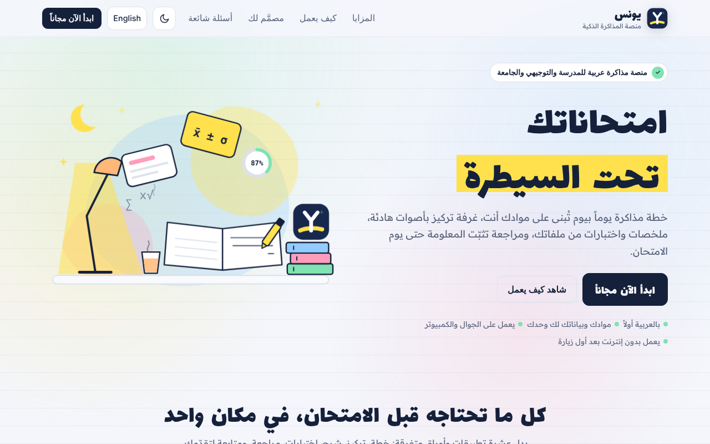
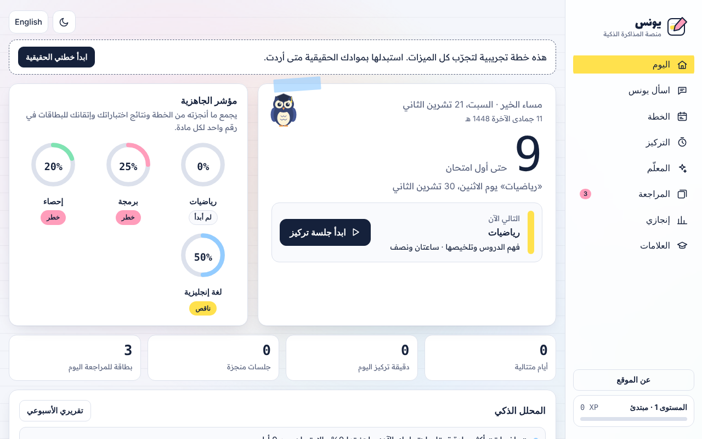
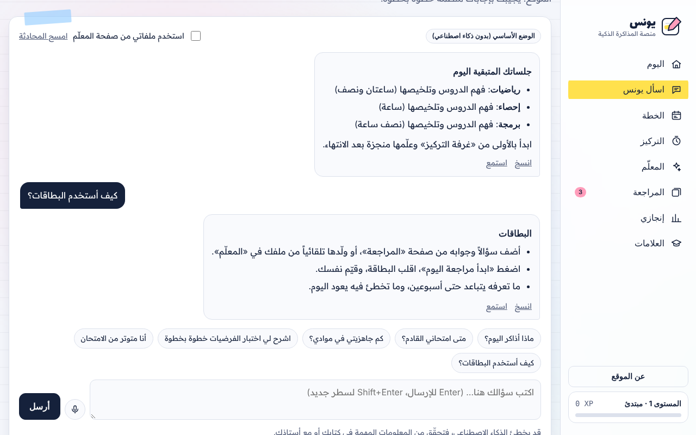
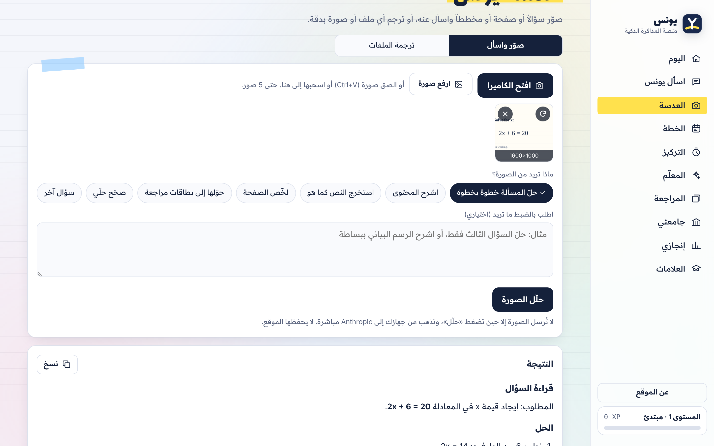
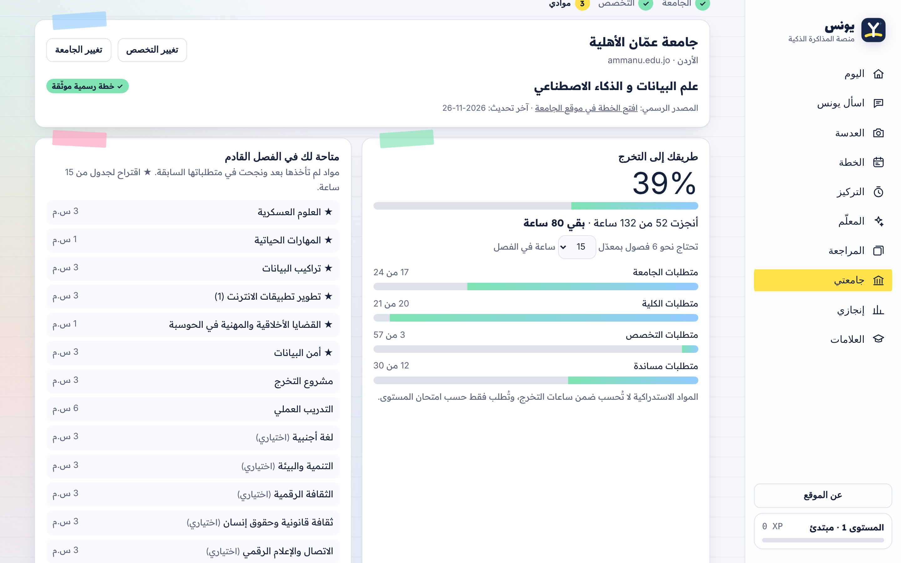
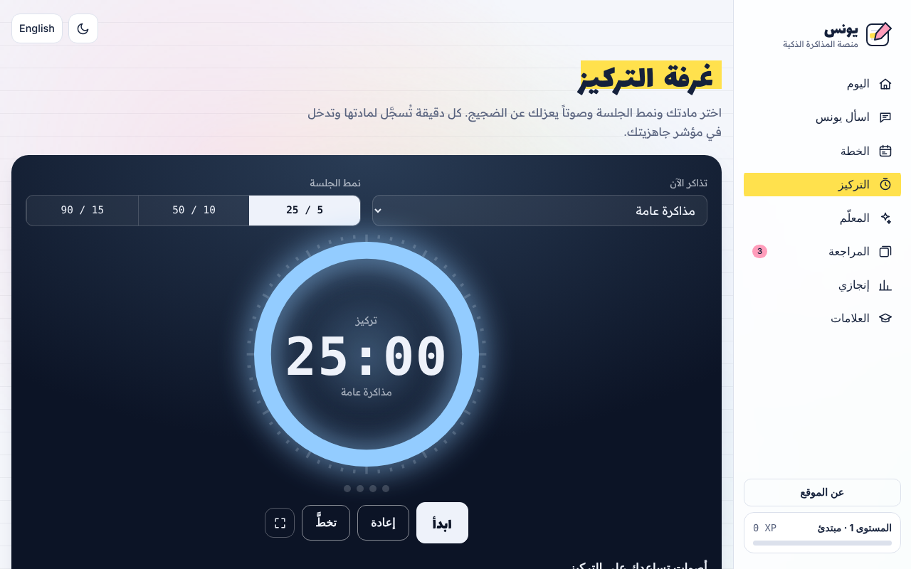
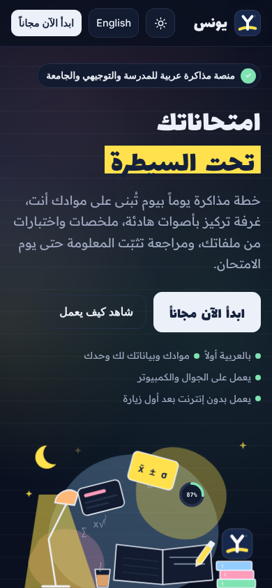

<div dir="rtl">

# يونس: منصة المذاكرة الذكية

> مساعدك الدراسي الذكي، باسم صانعه يونس أبو عجاج.

**منصة مذاكرة عربية مجانية لطلاب المدرسة والتوجيهي والجامعة:** خطة يومية تُبنى على موادك أنت، ومساعد محادثة «اسأل يونس»، و«عدسة يونس» التي تحلّ وتشرح ما تصوّره، وترجمة دقيقة لملفاتك، و«جامعتي» التي تعرض مواد تخصصك وطريقك إلى التخرج، وغرفة تركيز، ومعلّم ذكي، ومراجعة متباعدة، ودفتر أخطاء، وأوقات الصلاة والتاريخ الهجري.

> 📘 **[الدليل العملي: كيف بُنيت كل ميزة، ولماذا](GUIDE.md)**

- **الموقع:** https://younis-ajaj.github.io/Younis-Ajaj/
- **نسخة Claude** (المعلّم الذكي يعمل فيها بحساب Claude بلا مفتاح): https://claude.ai/artifact/TXJqkw8BpsTdVT36RQevMt



## المزايا

| الأداة | ماذا تفعل لك |
|---|---|
| **معالج البداية** | تختار مرحلتك وبلدك وموادك (قوائم جاهزة للمدرسة والتوجيهي وتخصصات الجامعة، أو تكتب مادتك) ومواعيد امتحاناتك في دقيقة. |
| **استيراد الجدول** | الصق جدول امتحاناتك أو ارفع ملفه، فتُستخرج المواد والتواريخ تلقائياً (وبالذكاء الاصطناعي إن فعّلته). |
| **الخطة اليومية** | خوارزمية توزّع ساعاتك على المواد حسب الصعوبة وقرب الامتحان، وتعيد توزيع ما فاتك دون أن تخسر ما أنجزته، وتصدّر الخطة إلى تقويم Google. |
| **اسأل يونس** | مساعد محادثة يجيبك بإجابات منظّمة خطوة بخطوة. يعرف خطتك وامتحاناتك وجاهزيتك، ويشرح أدوات الموقع، ويبحث في ملفاتك، ومع المعلّم الذكي يجيب عن أي سؤال دراسي. |
| **مؤشر الجاهزية** | نسبة لكل مادة تجمع ما أنجزته ونتائج اختباراتك وإتقانك للبطاقات. |
| **المحلل الذكي** | توصيات من أرقامك الحقيقية: أخطر مادة الآن، وتيرتك الأسبوعية، أفضل وقت لتركيزك، وأين تتكرر أخطاؤك. |
| **غرفة التركيز** | بومودورو (25/5، 50/10، 90/15) بأصوات مطر وأمواج، وكل دقيقة تُسجَّل لمادتها، وتتوقف تلقائياً عند وقت الصلاة إن فعّلته. |
| **المعلّم** | ملخص واختبار من ملفات PDF وWord وPowerPoint وExcel داخل متصفحك. ومع المعلّم الذكي: شرح، وخريطة ذهنية، واختبار بتوقيت، وبطاقات تلقائية، وطريقة فاينمان. |
| **عدسة يونس** | صوّر مسألة أو صفحة أو مخططاً بالكاميرا أو ارفع صورتها (حتى 5 صور)، فيحلّها خطوة بخطوة، أو يشرحها، أو يستخرج نصها حرفياً، أو يلخّصها، أو يصحّح حلّك، أو يحوّلها إلى بطاقات مراجعة. |
| **ترجمة الملفات** | PDF وWord وPowerPoint وExcel والنصوص والصور، وحتى الملفات المصوّرة: تُترجم كاملة إلى 18 لغة مع الحفاظ على العناوين والجداول، وتنزّلها ملف Word. |
| **جامعتي** | اختر بلدك وجامعتك من أكثر من 10 آلاف جامعة، فتظهر تخصصاتها فقط، ثم مواد خطتك فقط مع ساعاتها ومتطلباتها السابقة. خطط جامعة عمّان الأهلية (53 تخصصاً) موثّقة من موقعها الرسمي، والجامعات الأخرى عبر بحث ذكي في موقعها الرسمي أو بإدخال خطتك. |
| **طريقك إلى التخرج** | علّم ما نجحت فيه وما تدرسه الآن: نسبة إنجازك، وساعاتك المتبقية، وعدد الفصول، والمواد المتاحة لك في الفصل القادم مع اقتراح جدول، وإضافة مواد الفصل إلى خطتك بضغطة. |
| **المراجعة** | بطاقات بالتكرار المتباعد، ودفتر أخطاء يجمع كل سؤال أخطأت فيه مع سببه، وتحليل ذكي للأخطاء. |
| **إنجازي** | مستويات ونقاط وأوسمة، وخريطة نشاط 16 أسبوعاً، وتقرير أسبوعي ذكي، ونسخة احتياطية. |
| **شارك إنجازك** | صورة أنيقة بإنجازك الأسبوعي (دقائق التركيز، الجلسات، الجاهزية) جاهزة لواتساب وإنستغرام. |
| **العلامات** | كم تحتاج في النهائي لتصل إلى هدفك، ومعدلك الفصلي والتراكمي. |
| **مصمَّم لك** | واجهة عربية كاملة من اليمين إلى اليسار (والإنجليزية متى أردت)، والتاريخ الهجري، وأوقات الصلاة لـ 18 دولة عربية، وحكم وأمثال، ووضع «ليلة الامتحان». |

<p>


</p>
<p>


</p>
<p>


</p>

## دليل الطالب: ابدأ في دقيقة

1. افتح الموقع واضغط **«ابدأ الآن مجاناً»**.
2. اختر مرحلتك وبلدك، ثم موادك، ثم تاريخ امتحان كل مادة وصعوبتها.
3. اختر عدد ساعاتك اليومية، واضغط **«ابنِ خطتي»**.
4. كل يوم: افتح **«اليوم»**، وابدأ أول جلسة من **«غرفة التركيز»**، وعلّمها منجزة بعد الانتهاء.
5. اسأل **«اسأل يونس»** عن أي شيء: «ماذا أذاكر اليوم؟»، «متى امتحاني القادم؟»، «كيف أستخدم البطاقات؟».
6. قبل النوم: راجع بطاقاتك المستحقة من **«المراجعة»**.
7. ثبّت الموقع على شاشة جوالك من قائمة المتصفح ← «إضافة إلى الشاشة الرئيسية»، فيعمل بدون إنترنت بعد أول زيارة.

### المعلّم الذكي و«اسأل يونس»

- **بدون أي مفتاح** يجيبك «اسأل يونس» عن خطتك وامتحاناتك وجاهزيتك وطريقة استخدام كل أداة، ويبحث في ملفاتك، ويساعدك في توتر الامتحان. ويعمل الملخص والاختبار من الملفات داخل متصفحك.
- **مع مفتاح Claude API الخاص بك** (صفحة «المعلّم» ← «فعّل») تعمل كل أدوات الذكاء الاصطناعي، ويجيب «اسأل يونس» عن أي سؤال دراسي. يستخدم النموذج **Claude Opus 5.5** بتعليمات تدريس صارمة:
  - الدقة أولاً، ويقول إذا لم يكن متأكداً، ولا يخترع مصادر.
  - إجابة منظّمة: الخلاصة أولاً، ثم خطوات ومثال وأخطاء شائعة، وسؤال للتحقق من الفهم.
  - يكتب بلغة الطالب مع إبقاء المصطلحات العلمية بالإنجليزية.
  - يعلّمك ولا يحل امتحاناً مباشراً عنك.
  - إذا ذكر الطالب أزمة، يوجّهه بلطف إلى من يثق به أو إلى الطوارئ.
- **المفتاح** يبقى في متصفحك، ولا يُرسل إلا إلى Anthropic، ولا يدخل في النسخ الاحتياطية، ويُمسح بزر «امسح كل بياناتي». والاستهلاك على حسابك في Anthropic.

## الخصوصية والأمان

- **لا خادم ولا قاعدة بيانات ولا تسجيل دخول.** بيانات كل طالب في متصفحه فقط.
- **سياسة أمان صارمة (CSP):** لا سكربتات داخلية، ولا `eval`، ولا مكتبات من مواقع أخرى. كل المكتبات والخطوط محفوظة داخل الموقع.
- **لا تتبع ولا إعلانات ولا كوكيز.**
- التفاصيل في [SECURITY.md](../SECURITY.md).

## للمطوّرين

```
docs/                  الموقع المنشور (GitHub Pages من مجلد /docs)
younis-study/
  src/                 الكود المصدري مقسّماً حسب الميزة
    00-head.html … 25-landing.html   الواجهة والصفحة الرئيسية
    30-i18n.js … 36-i18n3.js         النصوص العربية والإنجليزية
    40-core.js                       الحالة والحفظ والتنقل والنقاط
    50-plan.js                       خوارزمية الخطة والتصدير
    60-today.js                      لوحة اليوم وغرفة التركيز
    70-tutor.js                      المعلّم وقراءة الملفات
    71-lens.js                       عدسة يونس: الكاميرا وتحليل الصور
    72-translate.js                  ترجمة الملفات والصور وتنزيل Word
    73-uni.js                        جامعتي ومتتبع التخرج
    75-site.js                       الصفحة الرئيسية والمعالج والصلاة
    77-ai.js                         عميل Claude والتحليل الذكي
    78-chat.js                       «اسأل يونس»
    80-rest.js                       المراجعة والإحصاءات والعلامات والتشغيل
  data/unis/           قائمة الجامعات لكل دولة (Hipo، رخصة MIT)
  data/catalog/        الخطط الدراسية الموثّقة (aau.json)
  tools/               build_unis.py وfetch_aau.py لتحديث البيانات
  fonts/               خطوط Lalezar وReadex Pro وIBM Plex Mono (رخصة OFL)
  tests/e2e.js         82 فحصاً آلياً (الوظائف، CSP، سهولة الوصول، الجوال، العدسة، الترجمة، الجامعات)
  GUIDE.md             الدليل العملي لكل ميزة
  build_web.py         يبني الموقع إلى ../docs
  build_artifact.py    يبني نسخة Claude في ملف واحد
```

```bash
cd younis-study
python3 build_web.py          # بناء الموقع
npm install                   # playwright وaxe-core للاختبارات
node tests/e2e.js             # تشغيل الفحوصات
```

**النشر:** يُنشر الموقع على GitHub Pages من فرع `gh-pages`، الذي يحمل محتوى مجلد `docs/`. بعد أي تعديل:

```bash
python3 younis-study/build_web.py && node younis-study/tests/e2e.js
git add -A && git commit -m "..."
git subtree split --prefix docs -b gh-pages && git push origin gh-pages
```

**نتائج الفحص:**
- الاختبارات الآلية: 82 من 82.
- Lighthouse على الكمبيوتر: 100 في الأداء وسهولة الوصول وأفضل الممارسات وSEO.
- Lighthouse على الجوال (بمحاكاة شبكة بطيئة): الأداء 91، والفئات الأخرى 100.

## خارطة الطريق

- مجموعات دراسة وتحديات بين الأصدقاء.
- بنوك أسئلة لمناهج التوجيهي والثانوية العامة.
- مزامنة اختيارية بين الأجهزة بحساب.
- تطبيق جوال.

## الشكر

- صنعه **يونس أبو عجاج**، طالب علم البيانات والذكاء الاصطناعي في جامعة عمّان الأهلية.
- البيانات: [Hipo University Domains](https://github.com/Hipo/university-domains-list) (MIT)، والخطط الدراسية من [الموقع الرسمي لجامعة عمّان الأهلية](https://www.ammanu.edu.jo/admission/undergraduate-programs/).
- المكتبات: [pdf.js](https://github.com/mozilla/pdf.js) (Apache-2.0)، و[JSZip](https://github.com/Stuk/jszip) (MIT)، و[Anthropic TypeScript SDK](https://github.com/anthropics/anthropic-sdk-typescript) (MIT).
- الخطوط: Lalezar وReadex Pro وIBM Plex Mono (SIL Open Font License).

</div>

---

## Younis (English)

A free, Arabic-first exam-preparation website for school and university students.

- **Every student picks their own courses** during onboarding.
- A day-by-day plan with rescheduling and Google Calendar export.
- **Ask Younis**, a chat assistant that knows your plan and answers in clear steps.
- A readiness index and smart insights.
- A Pomodoro focus room with ambient sound.
- A tutor that summarises and quizzes your PDF, Word and PowerPoint files.
- **Younis Lens:** snap or upload up to 5 photos and get a step-by-step solution, explanation, exact transcription, summary, solution check or flashcards (Claude vision).
- **File translation** into 18 languages: PDF, Word, PowerPoint, Excel, text, photos and scanned PDFs, downloadable as Word.
- **My university:** pick from 10,000+ universities, see only your university's majors and your own plan's courses; AAU's 53 official plans are verified, other universities via AI search of their official site or manual entry.
- **Graduation tracker:** hours left, semesters left, and the courses you can take next semester based on prerequisites.
- Spaced-repetition flashcards and a mistake notebook.
- Exam timetable import (paste or upload) and a shareable weekly progress image.
- Progress, badges, and a weekly AI report.
- Grade and GPA calculators.
- Hijri date and prayer-aware breaks.

There are no servers, accounts or trackers: data stays in the browser. The site sets a strict CSP and self-hosts all libraries and fonts.

The full AI tutor runs on **Claude Opus 5.5** with the student's own Claude API key, which stays in their browser. On the Claude version it runs through their Claude account instead.

Live site: https://younis-ajaj.github.io/Younis-Ajaj/
